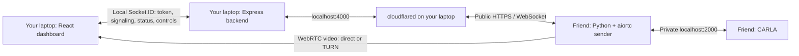

# GhostDriver

Watch a CARLA RGB camera on your local React dashboard while CARLA runs on a friend's GPU computer. The Express/Socket.IO backend stays on your laptop. A Cloudflare Tunnel lets the Python sender reach that backend over HTTPS; WebRTC carries video between the computers, directly or through an external TURN service.



Start here:

- **[Quick start: Mac + friend's GPU computer](docs/QUICK_START.md)** — automatic token setup, saved full AI profile, and a sender package ready to transfer.
- **[Steps to run on both computers](docs/STEPS_TO_RUN.md)** — complete numbered instructions, commands for Mac/Windows/Linux, parallel tasks, and everyday startup/shutdown.
- **[Your laptop setup](docs/LAPTOP_SETUP.md)** — tokens, TURN, local website/backend, Cloudflare Tunnel.
- **[Your friend's GPU computer setup](docs/FRIEND_SETUP.md)** — matching CARLA client, Python bridge, startup.
- **[Two-network verification and troubleshooting](docs/CONNECTION_TEST.md)** — first video, TURN-only test, recovery checks.
- [Socket.IO protocol](docs/protocol.md).

The dashboard shows sender connected, CARLA ready, video connecting, streaming, or disconnected. “Streaming” requires received, decoded frames. It shows received FPS, interval packet loss, and the selected WebRTC route (Direct, TURN relay, or Unknown when the browser cannot report it).

Each role has a separate connection token. Secrets live in ignored `.env` files, never in URLs or Vite variables. The dashboard token stays in memory until the page closes or you lock it. The authenticated backend supplies the same STUN/TURN configuration to the browser and Python sender.

Controls start stopped. Video retries cannot resume driving. After a signaling reconnect, select the sender and start video again; use **Resume controls** only when deliberately testing driving. W/A/S/D and emergency stop (Space or the button) are preserved. Python and backend watchdogs brake after 750 ms without control updates; camera loss, stream loss, disconnects, and emergency stop latch the brakes. Focus loss clears held keys and sends braking commands. This remains simulator software; the CARLA bridge needs real-installation testing.

The live bridge uses the trained YOLO checkpoint from `sudip-work`, spawns cars, bicycles and pedestrians, and annotates the WebRTC video. RAFT-Small prediction is available with `--prediction raft`; the estimated view is labeled separately beside the live camera. See **[AI and traffic setup](docs/AI_TRAFFIC.md)** for the commands to run on both computers and the integration record. No extra frontend/backend is needed from the other branch.

There is no synthetic fallback for CARLA footage. The existing synthetic demo is disabled by default; `ALLOW_DEMO=true` explicitly enables it for local tests. It requires the sender token and is labeled **DEMO VIDEO** / **SYNTHETIC DEMO**. Offline datasets and evaluation artifacts are not loaded by the live bridge.

From the repository root, using Node 22.12+:

```sh
npm run setup
npm run doctor
npm run dev
# Dashboard: http://localhost:5173
```

Validation commands:

```sh
npm test
npm run doctor
npm run build
npm run test:browser
python3 -m unittest discover -s carla-service/tests -v
python3 -m py_compile carla-service/bridge.py
# With AI dependencies installed, no CARLA required:
python carla-service/check_setup.py --models-only --prediction raft
```

Browser tests use a separate server on port 4100 and the installed Chrome browser. They use test-only credentials and an explicitly labeled synthetic sender to exercise WebRTC reception and control behavior. They do not validate CARLA or internet/TURN connectivity. With the Python requirements installed, unittest also runs an optional real aiortc/Socket.IO integration test using only a stubbed CARLA API and in-memory test frames; otherwise that test is explicitly skipped. See the connection test guide for checks requiring the two computers.
